# Portfolio Roadmap

A phased, implementation-ready backlog for evolving `sergioestrella.com` along five axes: **UX**, **UI**, **new sections**, **content workflow**, and **delivery tooling**. The roadmap is intentionally additive: it preserves the current Astro static-site architecture, the existing routes, and the file-based blog so that nothing breaks unless a content-model change is explicitly approved.

## How This Roadmap Is Executed

This file is a **product backlog**, not a plan. It says what the site should become. How the work runs is set by the owner's way of working, recorded in [`AGENTS.md`](../AGENTS.md):

1. Pick the next phase.
2. Run `/grilling` on it until no decision is open. The Phase 0 decisions that phase depends on are settled here.
3. Run `/dwp-create` with the outcome. The Deep Work Plan becomes the only planning document, with its criteria (`AC-*`), its tasks and their state. Do not copy tasks or progress back into this file.
4. Execute with `/dwp-execute`. Each task writes a failing test, implements, runs its gate, commits on the feature branch and runs `gentle-ai review assess`.
5. Close with the Final Review, using AI Diff Reviewer. The owner pushes, opens the pull request and merges.

When a plan changes what a phase should deliver, update the phase here so the backlog stays true.

---

## 1. Vision and Design Direction

The site today is a small, Spanish-first personal blog with a thin landing page and a richer "About" page. The target evolution is a more **editorial, credibility-focused personal portfolio** that:

- Tells a stronger story around work, talks, community, and clients.
- Uses subtle, intentional motion (GSAP) to add personality without hurting readability or accessibility.
- Keeps the current writing-first feel of the blog, with cleaner, single-column reading.
- Provides an internal authoring tool to turn raw transcripts into ready-to-edit blog posts.

Non-goals (for this roadmap):

- Full visual rewrite of `global.css`.
- Migration to Astro Content Collections (could be a later, separate initiative).
- Changing the deployment/hosting model.

---

## 2. Current Architecture (Source of Truth)

These are the exact files and patterns the roadmap builds on. Each phase below cites them.

### Pages and layouts

- [`src/pages/index.astro`](../src/pages/index.astro) — landing page: about hero + last 3 posts via `formatBlogPosts`.
- [`src/pages/about.astro`](../src/pages/about.astro) — bio, work experience list, projects (via `Projects.astro`).
- [`src/pages/blog/[...page].astro`](../src/pages/blog/[...page].astro) — paginated blog index (`pageSize: 6`).
- [`src/pages/category/[category].astro`](../src/pages/category/[category].astro) — category archive built from `frontmatter.category`.
- [`src/pages/rss.xml.js`](../src/pages/rss.xml.js) — RSS feed (uses `./blog/**/*.md`).
- [`src/layouts/MainLayout.astro`](../src/layouts/MainLayout.astro) — global shell, fonts, head, nav, footer.
- [`src/layouts/MainHead.astro`](../src/layouts/MainHead.astro) — SEO + Partytown/Google Analytics + Lite YouTube helper.
- [`src/layouts/BlogPostLayout.astro`](../src/layouts/BlogPostLayout.astro) — post shell: header + content + sidebars (categories + related).

### Components

- [`src/components/Nav.astro`](../src/components/Nav.astro), [`src/components/Footer.astro`](../src/components/Footer.astro)
- [`src/components/PostCard.astro`](../src/components/PostCard.astro), [`src/components/PostHeader.astro`](../src/components/PostHeader.astro)
- [`src/components/CategoryCloud.astro`](../src/components/CategoryCloud.astro), [`src/components/RelatedPosts.astro`](../src/components/RelatedPosts.astro)
- [`src/components/Pagination.astro`](../src/components/Pagination.astro)
- [`src/components/Projects.astro`](../src/components/Projects.astro) — keeps a hardcoded `PROJECTS` array inline.
- [`src/components/ExperienceItem.astro`](../src/components/ExperienceItem.astro)
- [`src/components/Link.astro`](../src/components/Link.astro), [`src/components/LiteYoutube.astro`](../src/components/LiteYoutube.astro), [`src/components/Seo.astro`](../src/components/Seo.astro)

### Data, utils, types

- [`src/data/navData.js`](../src/data/navData.js) — only `Acerca` and `Blog` today.
- [`src/data/siteData.json`](../src/data/siteData.json) — SEO defaults.
- [`src/js/utils.js`](../src/js/utils.js) — `formatBlogPosts`, `slugify`, `formatDate`; filters `draft` and future posts.
- [`src/js/jsonLD.js`](../src/js/jsonLD.js) — JSON-LD generation tied to frontmatter shape.
- [`src/types/posts.ts`](../src/types/posts.ts) — minimal `Post` interface (currently misses `author`, `robots`, and the `image` object shape).

### Styling

- [`src/styles/global.css`](../src/styles/global.css) — single, dense stylesheet with CSS variables and per-section rules. Notable for posts: the post layout becomes two columns at the `--md` breakpoint and wider at `--lg`.

```648:656:src/styles/global.css
  @media (--md) {
    grid-template-columns: 1fr minmax(auto, 220px);
    gap: var(--space-lg);
    align-items: start;
  }

  @media (--lg) {
    grid-template-columns: 1fr minmax(auto, 300px);
  }
```

### Tooling

- [`package.json`](../package.json) — `dev`, `build`, `preview`, `astro`, `check`, `lint`, `test`, `test:e2e`. **No** format script. Gates are described in [`docs/TESTING_GUIDE.md`](TESTING_GUIDE.md).
- [`astro.config.mjs`](../astro.config.mjs) — MDX, sitemap, Partytown, `astro-icon`.
- Content is **not** in a content collection; everything goes through `import.meta.glob("...blog/*.md")` + `formatBlogPosts()`. Any change to discovery or path shape must be applied to **all** consumers (homepage, blog index, category, related, RSS).

---

## 3. Phase 0 — Decisions Before Implementation

The decisions below were settled with the owner on 2026-11-05. None require code changes. Each later phase still runs its own `/grilling` for the details it owns.

### Content prerequisites

Phase 0 settles the decisions only. Each piece of content is gathered before the phase that uses it, not up front: talks, community, clients and testimonials before Phase 5, and the links before Phase 8. Phase 1 moves only the content that already exists, projects and work experience, and does not wait for the rest. Phase 5 creates the talks, community, clients and testimonials files and their types once their content and shape are settled.

- **Talks**: list of delivered talks with title, event, date, location/online, slides URL, recording URL, language, optional thumbnail.
- **Community**: organizations where Sergio is an organizer (Backbone UTP, GDG, etc.) with role, period, links, logo.
- **Clients showcase**: split into **employee work** (Globant, Selaski, Curoo, etc.) and **freelance/independent**. For each: client name, scope, role, period, logo, link, and a short outcome line. Be careful with wording to avoid implying ownership of employer projects.
- **Testimonials**: name, role, company, photo (optional), quote, source link or proof. Decide which can be published with names/photos.
- **Link hub**: label, URL, stable id and order for each link.

### Product/technical decisions

- **Tags vs. categories**: settled: **visual chips built from `category`**, with no content-model change. The site has 8 posts in 3 categories, so multi-tag frontmatter (`tags: ["a", "b"]`) would change posts, types, related-posts logic and routes for little gain. It stays deferred until there are enough posts for a tag to say something a category does not.
- **Transcript-to-post tool**: settled: **template-only first**, a deterministic Node script that scaffolds a Markdown file with frontmatter, headings and image/video placeholders from a `.txt` transcript, with no LLM, key or network. An AI-assisted body comes later behind an opt-in flag, with its own security decision, since it needs an API key.
- **GSAP scope**: settled: motion on the landing page, About and the blog index. **Post pages stay calm**, with no motion at all (settled in Phase 3), because motion competes with reading.
- **Accessibility floor**: settled for every animation: respect `prefers-reduced-motion` with no motion when it is set, keep keyboard focus, and never animate text being read. Each phase that adds motion proves it with a Playwright test that emulates reduced motion.
- **i18n**: settled: the site stays Spanish-only and new copy must match. Code and docs stay in English.
- **Link hub route**: settled: **`/enlaces`**, because people read this URL in a public bio. Existing routes are in English (`/about`, `/blog/`, `/category/`), while the copy is in Spanish.
- **Link hub click metrics**: settled: **Google Analytics events** on the property the site already uses, with no backend and no new vendor. Ad blockers hide some clicks, and delivery through Partytown is unproven, so Phase 8 first proves the event arrives; if it does not, the choice is reopened then. Counting redirects (`/l/<id>`) in a host function was rejected: it adds a server, ties the site to one host, and goes against the non-goals in section 1 and in `docs/PRODUCT_SPEC.md`.
- **Talks source**: settled as a direction: 6 of the 8 posts are in the category `Charlas`, so the Phase 5 talks section draws on those posts plus `src/data/talks.ts` for talks without a post, instead of a separate list that repeats them. Phase 5's grilling settles how the two combine.
- **Lint tool**: settled in Phase 7: ESLint with `eslint-plugin-astro`, because most of this site's markup lives in `.astro` files. Biome was the alternative, but it documents its Astro support as experimental.
- **Node version**: settled in Phase 7: `.nvmrc` holds `26`, the LTS line since 2026-10-28, and CI reads it. Node 25 and later no longer ship Corepack, so setup uses `npm install -g pnpm@<pinned version>`.

---

## 4. Phase 1 — Architecture Cleanup (No Visual Changes)

Goal: make later phases trivial and additive. No user-visible change.

### Changes

- Create a `src/data/` data layer:
  - `src/data/projects.ts` — move the inline `PROJECTS` array from [`src/components/Projects.astro`](../src/components/Projects.astro) here, typed. A project's `status` is `"deployed"` or `"development"`, and `Projects.astro` maps it to its Spanish label and CSS class, so the data names no CSS.
  - `src/data/experience.ts` — move the inline `workExperience` array from [`src/pages/about.astro`](../src/pages/about.astro) here, typed.
  - The talks, community, clients and testimonials files wait for Phase 5, because their types depend on decisions that phase makes. `navData.js` and `siteData.json` stay as they are.
- Expand [`src/types/posts.ts`](../src/types/posts.ts) to reflect the real frontmatter (`author`, `image: { src, alt }`, optional `robots`, optional `draft`). No `tags`: Phase 0 deferred multi-tag.
- Add `src/types/sections.ts` with shared types: `Project`, `ProjectStatus`, `Experience`.
- Introduce a small reusable `Section.astro` (title + icon + one slot) to avoid copy-pasting the `<span class="title">…</span>` pattern from `about.astro`.
- Refactor [`src/components/Projects.astro`](../src/components/Projects.astro) to consume `src/data/projects.ts` (no markup change).
- Prove there is no visible change: the build is byte-identical to `main`.

### Risks / guardrails

- Do not change the public API of `Projects.astro` — `about.astro` keeps importing it the same way.
- Keep the `Post` interface true to the posts: required fields are the ones every post has.

---

## 5. Phase 2 — Blog Readability (Single Column + Tags Below)

Goal: keep the article in one column at all breakpoints; move category and related posts beneath the article.

### Changes

The design reference is the post-page frames of `designs/site.pen`, signed by the owner.

- In [`src/styles/global.css`](../src/styles/global.css), drop the two-column grid on `.post-content`. The article and its footer are capped at `var(--content-lg)` (65ch) and centred.
- In [`src/layouts/BlogPostLayout.astro`](../src/layouts/BlogPostLayout.astro), replace the sidebar with a post footer under the article, `<aside aria-label="Sigue leyendo">`: a thin divider, the chip of this post's category only, then three posts. The posts stack under a gold top line each: the title, the description cut to one line, the author and date, and the cover image on the right.
- `selectRelatedPosts()` in [`src/js/utils.js`](../src/js/utils.js) picks the three posts: the same category first, newest first, then the newest posts from any category, never the current post. The block reads "Artículos relacionados" when all three are from its category and "Más artículos" otherwise, so a post alone in its category never ends empty.
- The cloud of all categories leaves the post page and stays on the blog index. The category badge in [`src/components/PostHeader.astro`](../src/components/PostHeader.astro) stays.
- The post title becomes the page's only `h1`, with class `h2`, so it looks the same.
- Left out: social sharing links, and styles for code (no post contains code).

### Risks / guardrails

- `.post-content` styles also affect `blockquote`, `strong`, `em`. Verify all existing posts visually after the change.
- Do not move `CategoryCloud` to a place that requires a new glob; it already uses the same discovery path.

---

## 6. Phase 3 — UX Motion with GSAP

Goal: add subtle but distinctive motion that respects accessibility and performance.

### Setup

- `gsap` is a runtime dependency, with ScrollTrigger.
- [`src/js/motion.js`](../src/js/motion.js) exports `revealCards(selector)`: one `gsap.matchMedia()` with `(prefers-reduced-motion: no-preference)`, so reduced motion reverts every change, and `ScrollTrigger.batch()` for the staggered reveal.
- The components that animate call it from Astro's bundled `<script>`, so only their pages load GSAP. GSAP never goes through Partytown.

### Where motion applies

- **Cards only:** post cards on the landing, `/blog/` and its pages and `/category/*`, and About's project cards. Each card below the fold at load reveals once as it scrolls in: opacity and `y: 20`, 0.6 s, a 0.1 s stagger, `power2.out`. Cards already on screen stay still, so nothing visible flashes, and if the script fails every card stays visible.
- **Hover lift:** CSS on the same cards, `transform` and `box-shadow` on `:hover` and `:focus-within`.
- **Not animated:** section headings and paragraphs, the landing hero (Phase 4 animates its new hero), and post pages, which load no motion code.
- **Every width:** one configuration; reduced motion is the only branch.

### Guardrails

- Animate transforms and `opacity` only, never `autoAlpha`: `visibility: hidden` would drop waiting cards from the tab order and the accessibility tree. Clear the inline styles after the reveal so the CSS hover still applies.
- Keep every trigger inside `matchMedia`, so it reverts on its own.
- Never animate text being read (Phase 0).
- Playwright runs every spec with reduced motion; `e2e/motion.spec.ts` opts out to prove the reveal, and also proves that reduced motion keeps every card still and that post pages run no GSAP.

---

## 7. Phase 4 — UI Refresh (Landing, About)

Goal: lift the landing and about pages from "simple" to "intentional", reusing existing tokens.

### Changes

The design reference is the landing and About frames of `designs/site.pen` (mockup v2), signed by the owner.

- **Landing** ([`src/pages/index.astro`](../src/pages/index.astro)):
  - Replace the single avatar + paragraph with a richer hero: name + role + 1-line value prop + CTA cluster (Conoceme más, Contáctame, GitHub).
  - Animate the new hero with a staggered intro on first paint, using CSS keyframes so nothing flashes before it runs and no script is needed (moved from Phase 3).
  - Add a full-width "Ahora" / "Now" strip between the hero and the metrics. `selectNow()` in `src/js/utils.js` picks its text: with a current job in `src/data/experience.ts` (a period ending in "Actualidad"), it names the job and the community; with none, it names the community, says he is open to collaborations and links "Hablemos" to the email.
  - Add a "Métricas" strip: talks delivered, years of experience, posts, computed from data and shown as large centered numbers. With motion allowed, each number counts up from 0 in about 400 ms, staggered, once the strip scrolls into view; the HTML keeps the final values, and reduced motion shows them at once.
  - Keep "Últimos posts" but reduce to 3 with consistent card height.
- **About** ([`src/pages/about.astro`](../src/pages/about.astro)):
  - Promote `getExperienceInYears()` into a reusable helper in `src/js/utils.js`.
  - Replace bare social icon row with a labeled "Encuéntrame" block (icon + handle text).
  - Add a "Servicios" section of four cards (icon, title, description), typed in `src/data/services.ts`. It replaced the earlier "Stack actual" chip group.
  - Update "Mi Experiencia" to the CV: five jobs, Fuse to Globant, with "Saber más" only where a link exists.
- **Editable copy**: every string on both pages lives in typed files under `src/data/`.

### Guardrails

- Do not change the public structure of `MainLayout` props.
- Keep all changes inside existing breakpoints (`--sm`, `--md`, `--lg`, `--xl`).

---

## 8. Phase 5 — New Sections (Talks, Community, Clients, Testimonials)

Goal: add the four sections, reusing the data layer from earlier phases. Settled through grilling on 2026-11-12 and delivered by PLAN_009; the signed frames are 7, 8 and 9 in `designs/site.pen`.

### Components and data

- `src/data/talks.ts`, `src/data/community.ts`, `src/data/clients.ts` and `src/data/testimonials.ts`, typed in `src/types/sections.ts`.
- **Talks source** (settles Phase 0's direction): only 1 of the 6 posts in `Charlas` is a talk Sergio gave; the others are events he organized or another speaker's talk. So `talks.ts` lists **only his talks**, and a talk may name its post with a `post` slug, from which the card takes its cover and a "Post" link. The event posts appear in Comunidad, as chips under the community that organized them.
- **Drafts**: an entry with `draft: true` is a placeholder still to fill in. `published()` in `src/js/utils.js` keeps it under `astro dev` and drops it from every build, and a section with nothing published renders nothing. The owner filled in the talks and community entries on 2026-11-13, so only the clients remain drafts: Clientes stays hidden, because the clients show in the experience timeline and there is not enough freelance work to show yet.
- `src/components/sections/Talks.astro` — Sergio's talks, newest first: title, event, date, place, language, and Inscripción, Slides, Grabación or Post links where the data has them. An upcoming talk is tagged "Próxima".
- `src/components/sections/Community.astro` — "Organizo" cards with role, period, link and event chips, and a "He colaborado con" chip row. A chip is a post named by slug, resolved through `formatBlogPosts()`, or an event published elsewhere as `{ title, url }`, such as the Pereira Tech Talks meetups, which opens in a new tab. A card shows six chips and folds the rest behind a native `<details>` toggle, "Ver N más". Backbone UTP moved here from the experience timeline, and the chips Phase 4 removed from the hero came back here.
- `src/components/sections/Clients.astro` — two subgroups, **Empresa** and **Freelance**, each card with role and outcome. Empresa entries credit the employer and never name its client ("· vía Fuse").
- `src/components/sections/Testimonials.astro` — quote cards with attribution: the recommendations people wrote publicly on Sergio's LinkedIn profile, word for word, published with the owner's approval. The company is optional.
- `src/components/Card.astro` — the card primitive (tag, image through `<Picture>`, title, description, CTAs and a slot). Project, talk and client cards render through it, and a testimonial's `figure` sits in its slot.
- Section icons `mdi:microphone-variant`, `mdi:account-group`, `mdi:handshake` and `mdi:comment-quote`, and four accent hues in [`src/styles/global.css`](../src/styles/global.css), `--accent-talks`, `--accent-community`, `--accent-clients` and `--accent-testimonials`, each `calc(var(--_hue) + offset)` with `--accent`'s saturation and lightness in light and dark. They color the icon box, card tags and card borders only.
- **Ahora**: `selectNow()` invites to the earliest published talk dated on or after the build day, ahead of the job and community text. The day is the **build** day: a deploy that is not rebuilt after the talk keeps inviting to it.
- The landing's "charlas" metric counts the published talks already given, no longer the posts in `Charlas`.

### Placement

- [`src/pages/about.astro`](../src/pages/about.astro): Encuéntrame → Servicios → Mi Experiencia → Charlas → Comunidad → Clientes → Testimonios → Mis proyectos.
- Optional later: promote each to its own page (e.g., `/talks`, `/community`) and add to [`src/data/navData.js`](../src/data/navData.js). Defer until each section has enough content to justify a page.

### Guardrails

- Empty data arrays render nothing (section hidden, not empty); drafts never reach a build.
- Logos and photos go under `src/assets/images/` and render through `<Picture>`, as post covers do.
- Testimonials and anything naming a third party are published only with the owner's approval.

---

## 9. Phase 6 — Internal Tool: Transcript → Blog Post

Goal: a repeatable command that turns a `.txt` transcript into a draft `src/pages/blog/<slug>.md` ready to edit, with image/video placeholders.

### Shape

- **Entry point**: a shell wrapper at `scripts/new-post-from-transcript.sh` accepting one positional arg (transcript path):

  ```bash
  scripts/new-post-from-transcript.sh ./transcripts/charla-gdg.txt
  ```

- The shell script delegates to a Node script (`scripts/new-post-from-transcript.mjs`) that does the real work. Reasons: cross-platform, easier file I/O, can grow into AI mode later. The shell wrapper keeps the user-facing command exactly as requested.

### Behavior

1. Validate the input (`.txt`, exists, non-empty).
2. Derive a `slug` from the file name (`slugify`-compatible) and a default `title` from the first non-empty line.
3. Detect simple structure in the transcript (blank-line paragraphs, "?" → questions) and emit Markdown headings every N paragraphs as `## Sección`.
4. Insert clearly-marked placeholders that are easy to find and replace:

   ```markdown
   <!-- IMAGE: replace with /images/<slug>-1.webp, alt text required -->
   <!-- VIDEO: replace with <LiteYoutube id="..." /> -->
   ```

5. Write the output to `src/pages/blog/<slug>.md` with frontmatter that matches existing posts:

   ```yaml
   ---
   layout: "../../layouts/BlogPostLayout.astro"
   title: "<Derived title>"
   date: <today, ISO>
   author: Sergio Estrella
   image: { src: "/src/assets/images/<slug>.webp", alt: "TODO: alt" }
   description: "TODO: meta description (≤160 chars)"
   category: "TODO"
   draft: true
   ---
   ```

6. Print next steps to stdout: replace placeholders, add real `image`/`description`/`category`, set `draft: false`, run `pnpm run build`.

### Add a script entry

- Optional pnpm alias in [`package.json`](../package.json):

  ```json
  {
    "scripts": {
      "new:post": "node scripts/new-post-from-transcript.mjs"
    }
  }
  ```

### Guardrails

- Output **must** be flat under `src/pages/blog/*.md`. Nested paths would mismatch the globs in [`src/pages/index.astro`](../src/pages/index.astro), [`src/pages/blog/[...page].astro`](../src/pages/blog/[...page].astro), [`src/pages/category/[category].astro`](../src/pages/category/[category].astro), and [`src/layouts/BlogPostLayout.astro`](../src/layouts/BlogPostLayout.astro), even though `rss.xml.js` would still pick them up.
- Default `draft: true` so a half-finished post never reaches the index/RSS (because `formatBlogPosts` filters drafts, and `rss.xml.js` goes through it too).
- Refuse to overwrite an existing slug; require `--force`.
- No network calls in the default mode. AI-assisted mode (later) goes behind a `--ai` flag and an env var.

---

## 10. Phase 7 — CI Pipelines and Lint Hook

Goal: run the existing gates on every pull request, and add a linter that also runs before each push. Nothing here changes what the site ships.

This phase has no dependency on the others, and every later phase benefits from it, so it can run first.

### Changes

- **Node:** add `.nvmrc` with `26`, and replace `corepack enable` in `README.md`, `AGENTS.md`, `docs/DEVELOPMENT_COMMANDS.md` and `scripts/require-pnpm.mjs`. If a host cannot build on 26, return to `24` everywhere, so CI and production stay on one version.
- **Lint:** add `pnpm run lint`, with ESLint. Fix the findings on the existing code in a commit of their own, with no change in `dist/`. The `arguments` use in the Google Analytics snippet in `MainHead.astro` stays, with a config exception and its reason. Formatting stays out of scope.
- **CI:** add `.github/workflows/ci.yml`, triggered on pull requests and on pushes to `main`:
  - `static` job: `pnpm run lint`, `pnpm run check`, `pnpm run test`, and `bash scripts/test-lint-setup.sh`.
  - `e2e` job: install Chromium with its system dependencies, run `pnpm run test:e2e` and `bash scripts/test-e2e-gate.sh`, and upload `tmp/e2e-evidence/` as an artifact with a short retention.
  - Both install with `pnpm install --frozen-lockfile`. `pnpm/action-setup` can read the version from `devEngines.packageManager`, so the pin stays in one place.
- **Pre-push hook:** add `.githooks/pre-push`, which runs `pnpm run lint`, and a `prepare` script that links only that hook into git's hooks directory. No hook manager is needed, and `core.hooksPath` stays unset, because on a tracked directory it would let a branch run hooks on checkout.
- **Docs:** update `AGENTS.md`, `README.md`, `docs/TESTING_GUIDE.md`, `docs/DEVELOPMENT_COMMANDS.md`, section 2 of this file, and the line in `.review/extension.md` that accepts the missing linter.

### Risks / guardrails

- `git push --no-verify` skips a hook, so CI is the gate and the hook is only a fast warning. Keep the hook to lint: the end-to-end suite is too slow for it.
- `prepare` also runs on the hosts' builds and in CI, where `.git` may be missing. It must not fail there. The Netlify and Cloudflare Pages previews on the pull request prove this.
- Give the workflow `permissions: contents: read`, and pin third-party actions to a commit SHA.
- Test evidence goes to CI artifacts and is never committed.
- CI does not deploy. Hosting stays as it is, per the non-goals in section 1.
- Making CI a required check is a GitHub setting that belongs to the owner.

---

## 11. Phase 8 — Link Hub with Click Metrics

Goal: one public page at a descriptive route that gathers the owner's links for use in social bios, and shows how people reach it and which links they open.

### Changes

- `src/pages/enlaces.astro` (route per Phase 0) renders the links on the existing layout. It adds no client framework or new library.
- `src/data/links.ts` holds the links, following the data layer convention from Phase 1. Each entry has a stable `id`, so metrics survive a change of label or URL. This phase does not need Phase 1 to land first.
- A small script sends one `link_click` event with the `link_id` when a link is opened.
- Link to the hub from each profile with `utm_source` (for example `?utm_source=instagram`). This needs no code, and Google Analytics then reports where visits came from.

### What was built (PLAN_011)

- Highlighted cards for the blog and the next event, then plain buttons for LinkedIn, GitHub, Backbone UTP and Platzi, from a mockup the owner signed in `designs/site.pen`. The page stays out of the nav and is indexed.
- Every link opens in a new tab with `rel="noopener"` and a hidden "(se abre en una pestaña nueva)". The owner chose the new tab; it also keeps the page, and its analytics worker, alive while the event goes out.
- Partytown forwards `gtag` as well as `dataLayer.push`, and `globalFns: ["gtag"]` puts `MainHead`'s inline `gtag` on the worker's window, because Partytown runs inline scripts inside a function. A main-thread push would serialize gtag's `Arguments` object, the likely cause of the reported loss of custom events.
- A spike on a deploy preview, sending a temporary `debug_mode`, showed `link_click` with its `link_id` in GA DebugView for every link before the page was styled. The shipped event carries only `link_id`.

### What the metrics can answer

- **Who visits:** aggregate figures only, such as visits, country, device and traffic source. The site cannot and should not identify individual visitors. Google Analytics already collects these figures for every page.
- **Which links are opened:** clicks per `link_id`, from the new event, as a minimum and not an exact count. Ad blockers hide part of the traffic.

### Risks / guardrails

- **Delivery is unproven.** Google Analytics runs in a Partytown worker, and the link click starts a navigation away from the page, so an event may be lost. A public report also describes custom events not reaching Google Analytics through Partytown. Start the plan with a spike that confirms the event in DebugView, on real links, on a deploy preview.
- **End-to-end tests cannot prove arrival.** `playwright.config.ts` blocks service workers and `e2e/fixtures.ts` aborts analytics requests, by design. A test can assert the event is handed over with the right `link_id`, and that the link still opens. Arrival in Google Analytics needs a criterion with the owner's sign-off.
- A blocked or failed analytics call must never stop a link from opening.
- Send only the link id. No personal data goes into event parameters.
- Each link is a real `<a>` that works by keyboard and without JavaScript.
- No post consumer is touched, so `formatBlogPosts()` and its six consumers stay out of scope.

---

## 12. Phase 9 — Posts for the Talks

Goal: a blog post for each talk in `src/data/talks.ts` that has none yet, so every Charlas card links to a written version and takes its cover from the post.

### Talks without a post

- "De documento a video: explicaciones narradas con IA en AWS por menos de un dólar", AWS User Group Pereira Meetup, 2026-11-23. Write it after the talk, with its slides and recording once they exist.
- "Spec Driven Development: Calidad asegurada desde el requerimiento", QA Conf, 2026-09-05. It has slides and a recording.
- "El Open Source en tiempos de IA", FLISoL 2026, 2026-05-07. It has slides.
- "Conversatorio PerTT: ¿Qué es una Hackathon?", Pereira Tech Talks, 2025. A panel, with no slides or recording.
- "De usuarios a creadores: Open Source para transformar la industria y Latinoamérica", FLISoL 2024. It has slides.
- "Introducción a Load Testing y Observability con K6 y New Relic", Noche de liderazgo y testing, 2022-05-12. It has slides and a recording.
- "Herramientas IA para desarrollo web", Google DevFest Pereira 2025. Its card links to `gdg-devfest-pereira`, a post about the event; a post about the talk itself is optional.

### Changes

- One post per talk under `src/pages/blog/`, in the `Charlas` category, with the frontmatter every post needs (`title`, `description`, `date`, `category`, `image` with `src` and `alt`).
- Set each talk's `post` to the new slug in `src/data/talks.ts`. The card then takes the post's cover and a "Post" button, so the talk's `image` can be deleted.
- Talks with a recording can start from Phase 6's transcript tool, which drafts a post from a transcript.

### Guardrails

- Posts go through `formatBlogPosts()`, so a post with `draft: true` or a future date is not published, and `findPost()` stops the build if a talk names it. Publish the post before linking it.
- Write the posts in Spanish, like the rest of the blog.
- A post naming another speaker or a third party needs the owner's approval before it is published.

---

## 13. Suggested Architecture (Visual)

```mermaid
flowchart TD
  subgraph data [src/data]
    projects[projects.ts]
    experience[experience.ts]
    talks[talks.ts]
    community[community.ts]
    clients[clients.ts]
    testimonials[testimonials.ts]
    links[links.ts]
  end

  subgraph components [src/components]
    Card[Card.astro]
    Section[Section.astro]
    SectionTalks[sections/Talks.astro]
    SectionCommunity[sections/Community.astro]
    SectionClients[sections/Clients.astro]
    SectionTestimonials[sections/Testimonials.astro]
    Projects[Projects.astro]
  end

  subgraph pages [src/pages]
    Index[index.astro]
    About[about.astro]
    BlogIndex["blog/[...page].astro"]
    PostLayout[layouts/BlogPostLayout.astro]
    Enlaces[enlaces.astro]
  end

  subgraph motion [src/js]
    Motion[motion.ts]
  end

  subgraph tools [scripts]
    Shell[new-post-from-transcript.sh]
    Node[new-post-from-transcript.mjs]
  end

  projects --> Projects
  experience --> About
  talks --> SectionTalks
  community --> SectionCommunity
  clients --> SectionClients
  testimonials --> SectionTestimonials
  links --> Enlaces

  SectionTalks --> Card
  SectionCommunity --> Card
  SectionClients --> Card
  SectionTestimonials --> Card
  Projects --> Card

  Section --> SectionTalks
  Section --> SectionCommunity
  Section --> SectionClients
  Section --> SectionTestimonials

  SectionTalks --> About
  SectionCommunity --> About
  SectionClients --> About
  SectionTestimonials --> About
  Projects --> About

  Motion --> Index
  Motion --> About
  Motion --> BlogIndex
  Motion --> PostLayout

  Shell --> Node
  Node -->|"writes draft .md"| PostLayout
```



---

## 14. Validation Plan

Each phase's plan selects its gates from [`docs/TESTING_GUIDE.md`](TESTING_GUIDE.md). A criterion closes only on a gate or on the owner's sign-off.

For every phase:

- Run `pnpm run lint && pnpm run check && pnpm run test && pnpm run test:e2e`, which also builds the site.
- Prove each user-visible behavior with a Playwright test titled with its `AC-*` id, with video. For a layout or an animation that must be judged by eye, add a second criterion for the owner's sign-off.

These checks have no automated gate, so run them by hand or ask for the owner's sign-off:

- Run `pnpm run dev` and visit at minimum:
  - `/` (landing)
  - `/about`
  - `/blog/`
  - `/blog/<one existing slug>` (single post)
  - `/category/<one existing slug>`
  - `/rss.xml`
- Verify content discovery still works: every existing post appears in the index, the right category, the right related list, and RSS.
- Lighthouse pass on `/` and a post page; no regression vs baseline on Performance, Accessibility, Best Practices, SEO.
- Manual a11y checks:
  - Tab order intact through new sections.
  - All images have `alt`.
  - Reduced-motion: with the OS setting on, no entrance/scroll animations should run (or they should run with `duration: 0`).
- Transcript tool:
  - Run on a sample `.txt`, confirm a draft `.md` is created with valid frontmatter.
  - Run `pnpm run build`; the draft should **not** appear in `/blog/` or RSS while `draft: true`.
  - Flip `draft: false`, rebuild, and confirm it appears everywhere it should.

---

## 15. Sequencing Summary

| Phase | Scope | Breaking? | Depends on |
|-------|-------|-----------|------------|
| 0 | Decisions + content gathering | No | — |
| 1 | Data layer + types + `Section.astro` | No | 0 |
| 2 | One-column post + tags below | No (visual) | 1 |
| 3 | GSAP motion + reduced-motion | No | 1 |
| 4 | Landing/About refresh | No | 1, 3 |
| 5 | Talks/Community/Clients/Testimonials | No | 1, 4 |
| 6 | Transcript → post tool | No | 0 |
| 7 | CI pipelines + lint + pre-push hook | No | — |
| 8 | Link hub + click metrics | No | 0 |
| 9 | Posts for the talks | No | 5 (6 optional) |

Phase numbers identify the work, and this table sets the dependencies. Phases 7 and 8 do not depend on Phases 1 to 6, and Phase 7 should run first so that later phases land with CI.

The only optional **breaking-ish** change is moving from `category` to multi-`tags` (Phase 2 option b). It is deferred until clearly justified.
